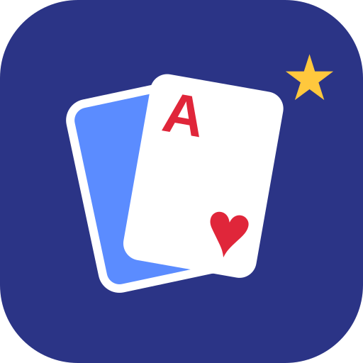
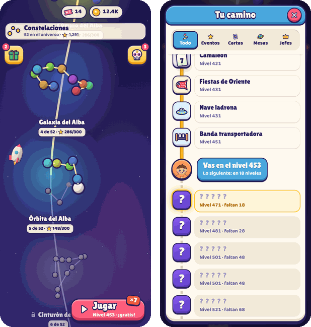
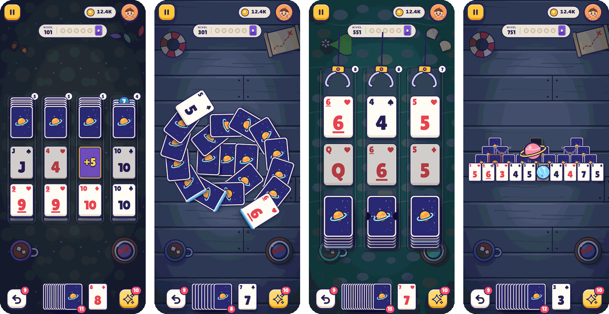
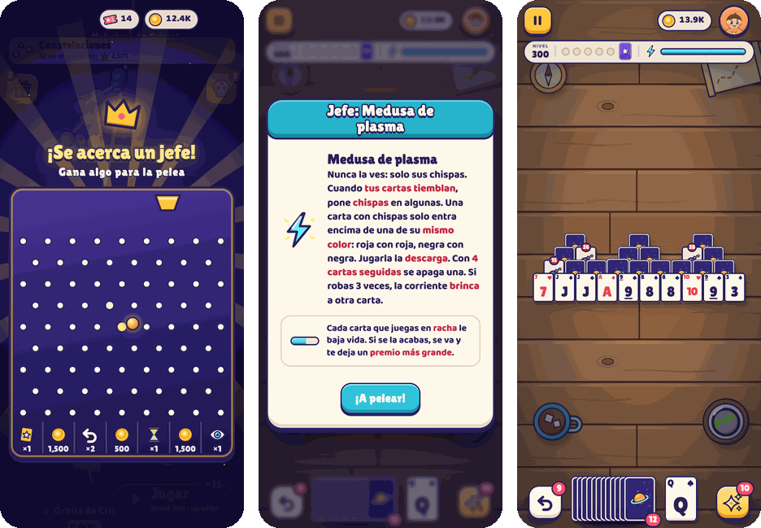

<p align="center">
  
</p>

<p align="center">
  
</p>

<p align="center">
  Un solitario TriPeaks que viaja por el espacio: cientos de planetas, cartas con poderes, mesas que se mueven, jefes y eventos de temporada.<br>
  Se juega en el navegador, en <b>PC</b> o en el <b>celular</b> (de preferencia acostado), y se instala como app.
</p>

<p align="center">
  
</p>

> [!NOTE]
> **Este proyecto se hizo 100% con [Claude](https://claude.com/claude-code).** Todo el código, el arte (dibujado con código: SVG, CSS y Three.js), las reglas, los niveles y las pruebas los escribió Claude a partir de las ideas, las pruebas en el iPhone y los «así no, mejor así» de Mau. Ni una línea a mano. La mascotita de arriba es la firma de Claude. 🧡

<p align="center">
  
</p>

---

## Contenido

- [Cómo se juega](#cómo-se-juega)
- [El viaje: universo, constelaciones y planetas](#el-viaje-universo-constelaciones-y-planetas)
- [Tu camino (qué se abre y cuándo)](#tu-camino-qué-se-abre-y-cuándo)
- [Mesas, cartas especiales y jefes](#mesas-cartas-especiales-y-jefes)
- [Eventos y premios](#eventos-y-premios)
- [Tienda (el market)](#tienda-el-market)
- [Modo dev](#modo-dev)
- [Correrlo en tu compu](#correrlo-en-tu-compu)
- [Por dentro](#por-dentro)

---

## Cómo se juega

Es un **TriPeaks**: hay cartas acomodadas en la mesa y un mazo abajo.

1. Toca una carta de la mesa que sea **un número arriba o uno abajo** de la carta del descarte (sobre un 7 va un 6 o un 8). **La A y la K se conectan.**
2. La carta vuela al descarte y ahora sigues desde ella.
3. Si no tienes jugada, toca el **mazo**: sale otra carta, pero se corta tu **racha**.
4. **Ganas** cuando limpias la mesa. **Pierdes** si se acaba el mazo y ya no hay jugadas.

Solo se pueden jugar las cartas **libres** (las que nada tapa). Al quitar las de encima, las de abajo se voltean.

**Dónde jugar.** En el **celular**, de preferencia **acostado**: se juega con el dedo y vibra cuando algo no se puede. Parado también funciona. En la **PC** se juega con el mouse y con teclado: **Espacio** o **Enter** roba, **Z** o **Retroceso** deshace y **Esc** pausa.

**Estrellas.** Al ganar te llevas de 1 a 3 estrellas según cuántas cartas te sobren en el mazo: con la mitad o más, 3 ★.

**Racha.** Cada carta seguida sin robar suma. La barra de arriba te regala cosas: cartas extra al mazo, un comodín, y a los 30 la **escoba**, que se lleva toda la capa de hasta abajo.

**Ayudas.** El botón dorado de abajo guarda tus ayudas. Solo salen las que sirven en ese tablero:

| Ayuda | Qué hace |
|---|---|
| Comodín | Vale cualquier número |
| Deshacer | Regresa la última jugada |
| +5 cartas | Cinco cartas más al mazo cuando ya no te quedan |
| Reloj de arena | Congela 3 turnos todo lo que lleva cuenta (bombas, cometas, jefes…) |
| Ver cartas | Voltea un momento todas las cartas tapadas |
| Llave maestra | Abre todos los candados y cortinas |
| Telescopio | Deja ver todo el tablero 5 turnos |
| Imán | Tu siguiente robo saca la carta que más te sirve |
| Varita | Súbele o bájale hasta 3 a una carta |
| Burbuja | Tu siguiente robo no corta la racha |
| Astronauta | Peter guarda una carta y la lleva al descarte cuando conecte |
| Láser y escudo | Contra los asteroides y la nave ladrona |

Todos los niveles se pueden ganar **sin ayudas**: el juego arma cada tablero y comprueba con un solucionador que tenga salida.

---

## El viaje: universo, constelaciones y planetas

<p align="center">
  
</p>

- El universo tiene **52 constelaciones**, cada una con **10 planetas** de **10 niveles**: **5,200 niveles** en el camino.
- El mapa es **3D** (Three.js, estilo caricatura). Tu **viajero** (un cohete o la nave que escojas) flota sobre donde vas.
- Entrar a un nivel nuevo cuesta **boletos**; ganarlo te los devuelve.
- Cada planeta termina en un **nivel final**, y cada constelación en un **jefe**. El jefe te da el **boleto dorado** para abrir el siguiente mundo (además te piden algunas estrellas).
- Con **30 de 30 estrellas** en un planeta se abre su **nivel secreto**.
- Cada planeta tiene su **mesa** (madera, hielo, metal…) y su postal para el **álbum**.

---

## Tu camino (qué se abre y cuándo)

Todo llega en niveles que terminan en 1, para que se sienta cada avance. La ventana **Tu camino** del juego dice qué sigue.

| Nivel | Qué se abre |
|---|---|
| 11 · 21 | Cartas con **candado** y **cartas regalo** · **Construir** con estrellas |
| 31 · 41 · 51 | **Racha cohete** · **Misiones del día** · **Logros** · mesa **enrollada** |
| 61 · 71 · 81 | **Carrera de 7** · cartas de **hielo** · **telescopio** · **lluvia de meteoritos** |
| 91 · 101 | Primera **colección** · mesa de **gravedad** · **apuesta ×2** · **jefe 1: Fénix estelar** (100) |
| 111 · 121 · 131 | **Tripulación lunar** · cartas **gemelas** · **lluvia de estrellas** · carta **doble** · **evento del mes** |
| 151 · 161 · 171 · 181 | **Nebulosa** · **lluvia de cometas** · **Peter el astronauta** · **flecha** · **festividades** |
| 201 → 851 | Una mesa nueva cada 50 niveles, dos cartas nuevas entre mesas, un jefe cada 100, apuestas más altas cada 100 (hasta ×15) y más festividades, colecciones y lluvias |

La lista completa, carta por carta, está en **[docs/cartas-mesas-jefes.md](docs/cartas-mesas-jefes.md)**.

---

## Mesas, cartas especiales y jefes

<p align="center">
  
</p>
<p align="center"><sub>Gravedad · Marea · Grúa de feria · Planetas en órbita</sub></p>

**Mesas.** Cada 50 niveles cambia la forma de jugar: la mesa **enrollada** se desenrolla mientras limpias, en **gravedad** solo juegas la de abajo de cada columna, la **marea** sube si robas mucho, el **agujero negro** se traga las cartas y las escupe revueltas, la **grúa de feria** jala columnas hacia arriba, los **planetas en órbita** tapan y destapan cartas al girar… Son 17 mesas hasta ahora.

**Cartas especiales.** Llegan de dos en dos y se presentan con su ventana la primera vez. Unas **se abren después** (candado, hielo, cortina, enredadera, dormida), otras **cambian con los turnos** (viva, fantasma, camaleón, clon), otras **cambian las reglas** (doble, flecha, dominó, espejo, eco), unas **no se juegan** (regalo, bomba, cometa) y otras **te ayudan** (moneda, rayo, imán, arcoíris, lazo, varita, burbuja). Son más de 35.

<p align="center">
  
</p>

**Jefes.** El nivel 100 de cada constelación trae una criatura que juega contra ti. Nunca la ves: solo lo que hace (fuego, tinta, chispas, viento…). Cada carta que juegas en racha le baja **vida**; si se la acabas, te deja un cofre más grande. Antes de pelear sueltas un meteorito en un **plinko** para ganarte algo. Son 8 y se turnan:

**Fénix estelar** (100) · **El Ilusionista** (200) · **Medusa de plasma** (300) · **Viento solar** (400) · **Mano alien** (500) · **Kraken** (600) · **Ballena glotona** (700) · **Reloj del vacío** (800)

En la **Arena de jefes** (desde el 100) vuelves a pelear contra los que ya venciste, por gusto, en Tranquilo, Normal o Furioso.

👉 Detalle de cada mesa, carta y jefe: **[docs/cartas-mesas-jefes.md](docs/cartas-mesas-jefes.md)**

---

## Eventos y premios

<p align="center">
  
</p>
<p align="center"><sub>Carrera de 7 · Colección de la semana · Tripulación lunar</sub></p>

| Evento | De qué se trata |
|---|---|
| **Regalo diario** | Un planeta por día; cada semana completa da una pieza de planeta y con 4 piezas un **escudo** que te salva un día que no entraste |
| **Racha cohete** | Gana niveles seguidos y junta estrellas para premios cada vez más grandes |
| **Misiones y logros** | 3 misiones al día con su cofre; logros para siempre con medallas de bronce a diamante |
| **Carrera de 7** | Gana 7 niveles nuevos seguidos contra 4 viajeros. El lugar se decide por estrellas: cofre de oro, plata, bronce o cobre |
| **Tripulación lunar** | Cada semana juntas estrellas con 4 viajeros para llegar a la base de bronce, plata u oro |
| **Construir** | Cada estrella nueva da un bloque; con bloques armas una estación de 5 piezas en cada planeta. Cada constelación tiene su estilo |
| **Colecciones** | Semanas temáticas (mar, gemas, dinosaurios, robots, música, cine…): ganas fichas y las cambias por exclusivos |
| **Evento del mes** | 25 niveles difíciles en 5 planetas con temática (Día de Muertos, Navidad, Halloween, Fiestas Patrias…) |
| **Festividades** | Fiestas de un día de México, Latinoamérica, Europa y Oriente (Candelaria, Guelaguetza, Las Fallas, Tanabata, Songkran…), cada una con su arte |
| **Lluvias** | Meteoritos, estrellas, cometas, aurora y cristales: caen sin aviso unos minutos y dan más premio |
| **Apuesta** | Apuesta ×2 hasta ×15 tus boletos en un nivel para ganar más |
| **Y más** | Tragamonedas galáctico para entrar a eventos, nave de rescate si te quedas sin boletos, pasaporte con sellos, códigos de regalo |

Todo premio sale en **burbujas** o en **cofres y cápsulas 3D**, y todo lleva animación.

Todo funciona **sin servidor**: los rivales de la carrera y la tripulación los simula el teléfono, y los códigos de regalo se revisan con una firma, sin internet.

---

## Tienda (el market)

<p align="center">
  
</p>

Con las monedas que ganas jugando compras cosas para verte distinto. La tienda tiene 3 grupos:

- **Tú:** tu personaje 3D (niño o niña, con piel, pelo y peinado) y sus **disfraces**, **marcos** del avatar y **títulos** bajo tu nombre.
- **Cartas:** **reversos** y **caras** de las cartas, con 14 temáticas (gatitos, perritos, globos, tropical, realeza…).
- **Viaje:** **viajeros** 3D que te llevan por el mapa, **fondos del espacio** y **marcos de postal**.

Hay piezas que no se venden: salen de eventos, festividades, colecciones, lluvias, el pasaporte, los secretos y el **tesoro escondido** de los códigos. De vez en cuando sale un **descuentazo** para toda la tienda por 24 horas.

---

## Modo dev


El modo dev es para **probar el juego sin romper tu partida**. Al prenderlo, todo lo que haces es una **copia de prueba**: al salir, tu partida vuelve tal como estaba.

**Cómo se prende:** en el **Perfil**, toca **8 veces seguidas** el título «Perfil». Salen dos botones de pruebas: **vista de dificultad** (en el tablero, abajo a la izquierda, dice qué % de veces gana un bot «casual») y **modo dev**. Otros 8 toques los esconden y los apagan.

**Para qué sirve:**

- **Galería de niveles** y **galería de planetas**: ver cualquier tablero o mundo sin llegar hasta él.
- **Ir al tablero**: escribes un número de nivel y lo juegas gratis.
- **Solucionador paso a paso**: te enseña cómo se gana el nivel, jugada por jugada.
- **Info por nivel**: qué mesa y qué cartas trae, y qué tan difícil es.
- **Adelantar el tiempo**: monedas o ayudas de sobra, la tienda completa o los exclusivos, pasar al otro día del regalo diario, cumplir misiones, ganar o perder la carrera, cerrar la semana de la tripulación, hacer caer una lluvia, ir al jefe de un evento…
- **Volver a ver** las ventanas de explicación, los avisos y el recorrido de botones.
- **Recuento y Reglas**: tablas con todo lo que da el camino, la tienda y cómo suben los jefes.
- **Medidas de pantalla**: revisar que todo quepa en cada iPhone.

Así Mau probaba cada idea en su teléfono antes de subirla.

<br clear="right">

---

## Correrlo en tu compu

No hace falta instalar nada: es HTML, CSS y JavaScript puro, sin compilar.

```bash
npm start          # abre http://localhost:5173
```

`npm start` también muestra la dirección para abrirlo en el **celular por Wi-Fi**. Se puede instalar como app (PWA) y funciona sin conexión.

```bash
npm test                     # comprueba que todos los niveles se ganan sin ayudas
node tests/difficulty.mjs    # curva de dificultad
```

> Los módulos ES no funcionan abriendo el archivo directo (`file://`): usa `npm start`.

---

## Por dentro

| Archivo | Qué hace |
|---|---|
| `js/engine.js` | Las reglas. Lo usan el juego, el solucionador, el bot y las pruebas: una sola fuente |
| `js/levels.js` | Arma los niveles al momento (sin archivos de datos) y revisa que se puedan ganar |
| `js/game.js` | El tablero, las animaciones y cada mecánica |
| `js/main.js` | Pantallas, ventanas, eventos y el flujo del juego |
| `js/galaxy.js`, `js/travelers.js`, `js/avatar3d.js` | Mapa, viajeros y personajes en 3D (Three.js) |
| `js/art.js`, `js/biomes.js`, `js/themes.js` | Iconos, cartas, mesas y temáticas dibujados con código |
| `js/economy.js`, `js/shop.js` | Precios, premios y la tienda |
| `js/events.js`, `js/race.js`, `js/crew.js`, `js/meteor.js`… | Eventos, carrera, tripulación, lluvias y demás |

Three.js y las letras vienen dentro del proyecto (`vendor/`, `fonts/`) para que funcione sin internet. Los textos del juego están en español.

---

<p align="center">
  <br>
  <sub>Hecho con 🧡 por Claude, con ideas, pruebas y paciencia de Mau.</sub>
</p>
