<p align="center">
  
</p>

<p align="center">
  <b>Un solitario TriPeaks que viaja por el espacio.</b><br>
  Cientos de planetas, cartas con poderes, mesas que se mueven, jefes y fiestas de todo el mundo.<br>
  Se juega en el navegador, en <b>PC</b> o en el <b>celular</b> (de preferencia acostado), y se instala como app.
</p>

<p align="center">
  &nbsp; <b>5,200 niveles</b> &nbsp;·&nbsp; 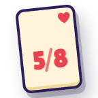&nbsp; <b>35 cartas especiales</b> &nbsp;·&nbsp; 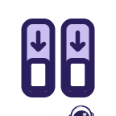&nbsp; <b>17 mesas</b> &nbsp;·&nbsp; &nbsp; <b>8 jefes</b> &nbsp;·&nbsp; &nbsp; <b>51 fiestas</b>
</p>

<p align="center">
  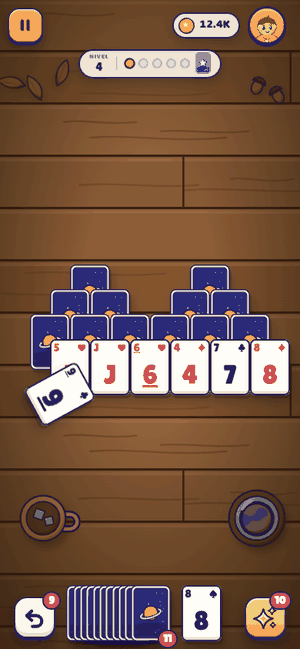
</p>

> [!NOTE]
> 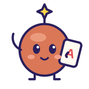
> **Este proyecto se hizo 100% con [Claude](https://claude.com/claude-code).** Todo el código, el arte (dibujado con código: SVG, CSS y Three.js), las reglas, los niveles y las pruebas los escribió Claude a partir de las ideas, las pruebas en el iPhone y los «así no, mejor así» de Mau. Ni una línea a mano. La mascotita es la firma de Claude. 🧡

<table align="center"><tr>
<td align="center"><a href="#como-se-juega"><br><sub><b>Cómo se juega</b></sub></a></td>
<td align="center"><a href="#camino"><br><sub><b>Tu camino</b></sub></a></td>
<td align="center"><a href="#cartas"><br><sub><b>Cartas</b></sub></a></td>
<td align="center"><a href="#mesas"><br><sub><b>Mesas</b></sub></a></td>
<td align="center"><a href="#jefes"><br><sub><b>Jefes</b></sub></a></td>
<td align="center"><a href="#eventos"><br><sub><b>Eventos</b></sub></a></td>
<td align="center"><a href="#tienda">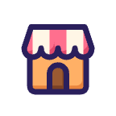<br><sub><b>Tienda</b></sub></a></td>
<td align="center"><a href="#dev">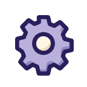<br><sub><b>Modo dev</b></sub></a></td>
</tr></table>

---

<a id="como-se-juega"></a>

##  Cómo se juega

Es un **TriPeaks**: hay cartas acomodadas en la mesa y un mazo abajo.

| | |
|:-:|---|
| **1** | Toca una carta de la mesa que sea **un número arriba o uno abajo** de la del descarte (sobre un 7 va un 6 o un 8). **La A y la K se conectan.** |
| **2** | La carta vuela al descarte y ahora sigues desde ella. |
| **3** | ¿Sin jugada? Toca el **mazo**: sale otra carta, pero se corta tu **racha**. |
| **4** | **Ganas** cuando limpias la mesa. **Pierdes** si se acaba el mazo y ya no hay jugadas. |

Solo se juegan las cartas **libres** (las que nada tapa). Al quitar las de encima, las de abajo se voltean.

 **Estrellas.** Al ganar te llevas de 1 a 3 según cuántas cartas te sobren: con la mitad del mazo o más, 3 ★.<br>
 **Racha.** Cada carta seguida sin robar suma. La barra de arriba regala cartas extra, un comodín y, a los 30, la **escoba** 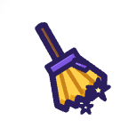, que se lleva toda la capa de hasta abajo.<br>
📱 **Dónde jugar.** En el **celular**, de preferencia **acostado**; vibra cuando algo no se puede. En la **PC**, con mouse o teclado: **Espacio**/**Enter** roba, **Z**/**Retroceso** deshace y **Esc** pausa.

###  Ayudas

El botón dorado de abajo guarda tus ayudas. Solo salen las que sirven en ese tablero.

<table>
<tr><td align="center" width="20%"><br><sub><b>Comodín</b><br>Vale cualquier número</sub></td><td align="center" width="20%"><br><sub><b>Deshacer</b><br>Regresa la última jugada</sub></td><td align="center" width="20%"><br><sub><b>+5 cartas</b><br>Cinco cartas más al mazo cuando ya no te quedan</sub></td><td align="center" width="20%">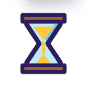<br><sub><b>Reloj de arena</b><br>Congela 3 turnos todo lo que lleva cuenta (bombas, cometas, jefes…)</sub></td><td align="center" width="20%"><br><sub><b>Ver cartas</b><br>Voltea un momento todas las tapadas</sub></td></tr>
<tr><td align="center" width="20%"><br><sub><b>Llave maestra</b><br>Abre todos los candados y cortinas</sub></td><td align="center" width="20%">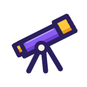<br><sub><b>Telescopio</b><br>Deja ver todo el tablero 5 turnos</sub></td><td align="center" width="20%"><br><sub><b>Imán</b><br>Tu siguiente robo saca la carta que más te sirve</sub></td><td align="center" width="20%"><br><sub><b>Varita</b><br>Súbele o bájale hasta 3 a una carta</sub></td><td align="center" width="20%">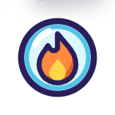<br><sub><b>Burbuja</b><br>Tu siguiente robo no corta la racha</sub></td></tr>
<tr><td align="center" width="20%"><br><sub><b>Astronauta</b><br>Peter guarda una carta y la lleva al descarte cuando conecte</sub></td><td align="center" width="20%">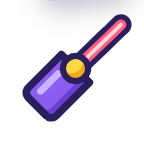<br><sub><b>Láser</b><br>Rompe las piedras de los asteroides</sub></td><td align="center" width="20%"><br><sub><b>Escudo</b><br>La nave ladrona ya no te roba</sub></td></tr>
</table>

> [!TIP]
> Todos los niveles se pueden ganar **sin ayudas**: el juego arma cada tablero al momento y comprueba con un solucionador que tenga salida.

---

##  El viaje: universo, constelaciones y planetas

<p align="center">
  
</p>

| | |
|:-:|---|
|  | El universo tiene **52 constelaciones**, cada una con **10 planetas** de **10 niveles**: **5,200 niveles** |
|  | El mapa es **3D** (Three.js, estilo caricatura). Tu **viajero** (un cohete o la nave que escojas) flota sobre donde vas |
|  | Entrar a un nivel nuevo cuesta **boletos**; ganarlo te los devuelve |
|  | Cada constelación termina en un **jefe** que te da el **boleto dorado** para abrir el siguiente mundo |
|  | Con **30 de 30 estrellas** en un planeta se abre su **nivel secreto** |
|  | Cada planeta tiene su **mesa** (madera, hielo, metal…) y su postal para el **álbum** |

---

<a id="camino"></a>

##  Tu camino

Todo llega en niveles que terminan en 1 (los jefes, en los que terminan en 00), para que cada avance se sienta. Es la misma lista que el **Recuento** del modo dev. Toca cada tramo para abrirlo.

<sub>🃏 Carta especial · 🟪 Mesa · 👾 Jefe · 🎉 Evento — pasa el mouse sobre los iconitos para ver su nombre y fecha.</sub>

<details open>
<summary><b>Niveles 1–100</b> · Constelación 1 · aprendes lo básico &nbsp;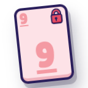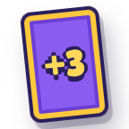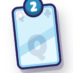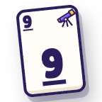</summary>

<table>
<tr><th></th><th>Nivel</th><th>Tipo</th><th align="left">Qué llega</th></tr>
<tr><td align="center"></td><td align="center"><b>11</b></td><td nowrap>🃏 Carta</td><td><b>Candado</b><br><sub>No se juega hasta que juegues la carta con la <b>llave</b> de su color</sub></td></tr>
<tr><td align="center"></td><td align="center"><b>21</b></td><td nowrap>🎉 Evento</td><td><b>Construir con estrellas</b><br><sub>Cada estrella nueva es un <b>bloque</b>: arma una estación de 5 piezas en cada planeta</sub></td></tr>
<tr><td align="center"></td><td align="center"><b>21</b></td><td nowrap>🃏 Carta</td><td><b>Carta regalo</b><br><sub>Destápala y mete cartas extra a tu mazo</sub></td></tr>
<tr><td align="center"></td><td align="center"><b>31</b></td><td nowrap>🎉 Evento</td><td><b>Racha cohete</b><br><sub>Gana niveles seguidos y junta premios cada vez más grandes</sub></td></tr>
<tr><td align="center"></td><td align="center"><b>41</b></td><td nowrap>🎉 Evento</td><td><b>Misiones del día</b><br><sub>3 misiones al día con su cofre; cambian a medianoche</sub></td></tr>
<tr><td align="center"></td><td align="center"><b>51</b></td><td nowrap>🎉 Evento</td><td><b>Logros</b><br><sub>Para siempre, con medallas de bronce a diamante</sub></td></tr>
<tr><td align="center"></td><td align="center"><b>51</b></td><td nowrap>🟪 Mesa</td><td><b>Mesa enrollada</b><br><sub>Llega enrollada: limpia las primeras cartas y salen más del rollo</sub></td></tr>
<tr><td align="center"></td><td align="center"><b>61</b></td><td nowrap>🎉 Evento</td><td><b>Carrera de 7</b><br><sub>Gana 7 niveles nuevos seguidos contra 4 viajeros; el podio va por estrellas</sub></td></tr>
<tr><td align="center"></td><td align="center"><b>71</b></td><td nowrap>🃏 Carta</td><td><b>Hielo</b><br><sub>Se derrite: cada carta que juegas le quita 1</sub></td></tr>
<tr><td align="center"></td><td align="center"><b>81</b></td><td nowrap>🎉 Evento</td><td><b>Lluvia de meteoritos</b><br><sub>2 o 3 veces por semana, 30 min sin aviso: boletos a mitad y premios propios</sub></td></tr>
<tr><td align="center"></td><td align="center"><b>81</b></td><td nowrap>🃏 Carta</td><td><b>Telescopio</b><br><sub>Por 3 turnos se ven todas las cartas, también las tapadas</sub></td></tr>
<tr><td align="center"></td><td align="center"><b>91</b></td><td nowrap>🎉 Evento</td><td><b>Colecciones</b><br><sub>Semanas temáticas: juntas fichas y las cambias por exclusivos (2 semanas al mes)</sub><br> 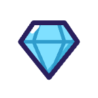 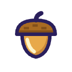 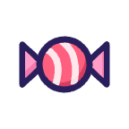</td></tr>
<tr><td align="center"></td><td align="center"><b>100</b></td><td nowrap>👾 Jefe</td><td><b>Fénix estelar</b><br><sub>Cae fuego sobre las libres y tapa sus números</sub></td></tr>
</table>

</details>

<details open>
<summary><b>Niveles 101–200</b> · Constelación 2 · llegan los eventos &nbsp;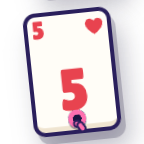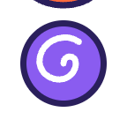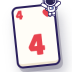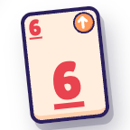</summary>

<table>
<tr><th></th><th>Nivel</th><th>Tipo</th><th align="left">Qué llega</th></tr>
<tr><td align="center">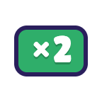</td><td align="center"><b>101</b></td><td nowrap>🎉 Evento</td><td><b>Apuesta hasta ×2</b><br><sub>Apuesta tus boletos para ganar más</sub></td></tr>
<tr><td align="center"></td><td align="center"><b>101</b></td><td nowrap>🟪 Mesa</td><td><b>Gravedad</b><br><sub>Cartas en columnas: solo juegas la de abajo y la columna cae</sub></td></tr>
<tr><td align="center"></td><td align="center"><b>111</b></td><td nowrap>🎉 Evento</td><td><b>Tripulación lunar</b><br><sub>Cada semana juntas estrellas con 4 viajeros para 3 bases con cofre</sub></td></tr>
<tr><td align="center"></td><td align="center"><b>121</b></td><td nowrap>🎉 Evento</td><td><b>Lluvia de estrellas</b><br><sub>15 min sin aviso: monedas ×3 y hasta 3 premios</sub></td></tr>
<tr><td align="center"></td><td align="center"><b>121</b></td><td nowrap>🃏 Carta</td><td><b>Cartas gemelas</b><br><sub>Atadas con lazo: al jugar una, la otra cae al descarte</sub></td></tr>
<tr><td align="center"></td><td align="center"><b>131</b></td><td nowrap>🎉 Evento</td><td><b>Eventos del mes</b><br><sub>25 niveles en 5 planetas con la temática del mes</sub><br>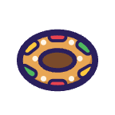   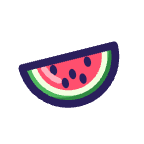 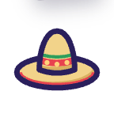 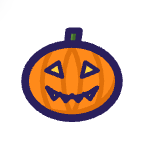  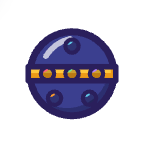</td></tr>
<tr><td align="center"></td><td align="center"><b>131</b></td><td nowrap>🃏 Carta</td><td><b>Carta doble</b><br><sub>Vale dos números: entra con cualquiera</sub></td></tr>
<tr><td align="center">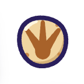</td><td align="center"><b>141</b></td><td nowrap>🎉 Evento</td><td><b>Colecciones nuevas y 3.ª semana</b><br><sub>Llegan dinosaurios y robots: colección 3 semanas al mes</sub><br> </td></tr>
<tr><td align="center"></td><td align="center"><b>151</b></td><td nowrap>🟪 Mesa</td><td><b>Nebulosa</b><br><sub>Solo ves 3 grupos; vacía uno y de la nebulosa sale otro</sub></td></tr>
<tr><td align="center"></td><td align="center"><b>161</b></td><td nowrap>🎉 Evento</td><td><b>Lluvia de cometas</b><br><sub>20 min: jugar no gasta boletos y cada victoria da 1 más</sub></td></tr>
<tr><td align="center"></td><td align="center"><b>171</b></td><td nowrap>🃏 Carta</td><td><b>Astronauta</b><br><sub>Peter te guarda una carta y la manda al descarte cuando conecte</sub></td></tr>
<tr><td align="center"></td><td align="center"><b>181</b></td><td nowrap>🎉 Evento</td><td><b>Festividades de un día</b><br><sub>Fiestas de un día, cada una con su arte y sus niveles</sub><br> 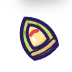 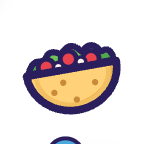  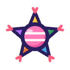   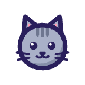    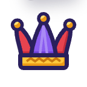</td></tr>
<tr><td align="center"></td><td align="center"><b>181</b></td><td nowrap>🃏 Carta</td><td><b>Flecha</b><br><sub>La siguiente jugada tiene que ser uno más (↑) o uno menos (↓)</sub></td></tr>
<tr><td align="center"></td><td align="center"><b>191</b></td><td nowrap>🎉 Evento</td><td><b>Colecciones de Arte, Música y Cine</b><br><sub>Arte, música y cine: ya hay colección todas las semanas</sub><br>  </td></tr>
<tr><td align="center">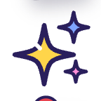</td><td align="center"><b>200</b></td><td nowrap>👾 Jefe</td><td><b>El Ilusionista</b><br><sub>Cambia el número de todas las cartas boca arriba</sub></td></tr>
</table>

</details>

<details>
<summary><b>Niveles 201–300</b> · jefe: Medusa de plasma &nbsp;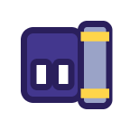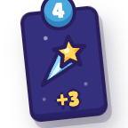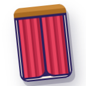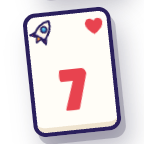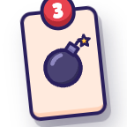</summary>

<table>
<tr><th></th><th>Nivel</th><th>Tipo</th><th align="left">Qué llega</th></tr>
<tr><td align="center"></td><td align="center"><b>201</b></td><td nowrap>🎉 Evento</td><td><b>Aurora</b><br><sub>20 min con colección abierta: fichas ×2 y hasta 2 premios</sub></td></tr>
<tr><td align="center">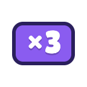</td><td align="center"><b>201</b></td><td nowrap>🎉 Evento</td><td><b>Apuesta hasta ×3</b><br><sub>Ahora puedes apostar hasta ×3</sub></td></tr>
<tr><td align="center"></td><td align="center"><b>201</b></td><td nowrap>🟪 Mesa</td><td><b>Hangar</b><br><sub>Columnas que salen de un hangar; al vaciar una, se recorren</sub></td></tr>
<tr><td align="center"></td><td align="center"><b>221</b></td><td nowrap>🃏 Carta</td><td><b>Cometa</b><br><sub>Destápalo antes de que su cuenta llegue a 0 y suma racha</sub></td></tr>
<tr><td align="center"></td><td align="center"><b>231</b></td><td nowrap>🎉 Evento</td><td><b>Festividades de leyendas mexicanas</b><br><sub>Leyendas: nahuales, chaneques, la Llorona, la Catrina…</sub><br>    </td></tr>
<tr><td align="center"></td><td align="center"><b>231</b></td><td nowrap>🃏 Carta</td><td><b>Cortina</b><br><sub>Sigue boca abajo hasta que juegues la carta del telón</sub></td></tr>
<tr><td align="center">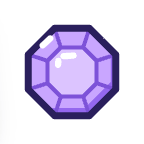</td><td align="center"><b>241</b></td><td nowrap>🎉 Evento</td><td><b>Lluvia de cristales</b><br><sub>10 min cada dos semanas: cada victoria puede dar una ayuda</sub></td></tr>
<tr><td align="center"></td><td align="center"><b>251</b></td><td nowrap>🟪 Mesa</td><td><b>Bitácora</b><br><sub>Hojas encimadas; por las escotillas se juega la de abajo</sub></td></tr>
<tr><td align="center"></td><td align="center"><b>271</b></td><td nowrap>🃏 Carta</td><td><b>Cohete turbo</b><br><sub>Tus 3 jugadas siguientes valen doble en la racha</sub></td></tr>
<tr><td align="center">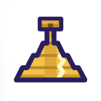</td><td align="center"><b>281</b></td><td nowrap>🎉 Evento</td><td><b>Fiestas de México</b><br><sub>Bandera, equinoccio en las pirámides y las posadas</sub><br>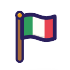 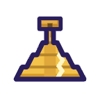 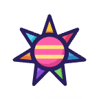</td></tr>
<tr><td align="center"></td><td align="center"><b>281</b></td><td nowrap>🃏 Carta</td><td><b>Bomba</b><br><sub>Destápala antes de 0 o quema 3 cartas de tu mazo</sub></td></tr>
<tr><td align="center"></td><td align="center"><b>300</b></td><td nowrap>👾 Jefe</td><td><b>Medusa de plasma</b><br><sub>Chispas: esas cartas solo entran sobre una de su color</sub></td></tr>
</table>

</details>

<details>
<summary><b>Niveles 301–400</b> · jefe: Viento solar &nbsp;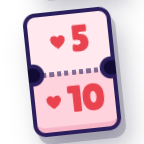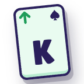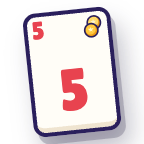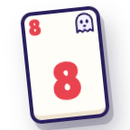</summary>

<table>
<tr><th></th><th>Nivel</th><th>Tipo</th><th align="left">Qué llega</th></tr>
<tr><td align="center"></td><td align="center"><b>301</b></td><td nowrap>🎉 Evento</td><td><b>Apuesta hasta ×5</b><br><sub>Ahora puedes apostar hasta ×5</sub></td></tr>
<tr><td align="center"></td><td align="center"><b>301</b></td><td nowrap>🟪 Mesa</td><td><b>Marea</b><br><sub>Si robas mucho sube el agua y tapa las de abajo</sub></td></tr>
<tr><td align="center"></td><td align="center"><b>321</b></td><td nowrap>🃏 Carta</td><td><b>Boleto partido</b><br><sub>Dos mitades: juega una y la otra se queda</sub></td></tr>
<tr><td align="center"></td><td align="center"><b>331</b></td><td nowrap>🎉 Evento</td><td><b>Fiestas de América</b><br><sub>De Bolivia a Rapa Nui, de Oaxaca a Colombia</sub><br>         </td></tr>
<tr><td align="center"></td><td align="center"><b>331</b></td><td nowrap>🃏 Carta</td><td><b>Carta viva</b><br><sub>Su número sube o baja con cada turno</sub></td></tr>
<tr><td align="center"></td><td align="center"><b>351</b></td><td nowrap>🟪 Mesa</td><td><b>Agujero negro</b><br><sub>Se traga las cartas y las escupe con los números revueltos</sub></td></tr>
<tr><td align="center"></td><td align="center"><b>371</b></td><td nowrap>🃏 Carta</td><td><b>Carta moneda</b><br><sub>Se juega normal y te da monedas</sub></td></tr>
<tr><td align="center"></td><td align="center"><b>381</b></td><td nowrap>🎉 Evento</td><td><b>Fiestas de Europa</b><br><sub>Vikingos, Las Fallas, San Patricio, Midsommar…</sub><br>         </td></tr>
<tr><td align="center"></td><td align="center"><b>381</b></td><td nowrap>🃏 Carta</td><td><b>Fantasma</b><br><sub>Aparece y desaparece; solo se juega cuando se ve</sub></td></tr>
<tr><td align="center"></td><td align="center"><b>400</b></td><td nowrap>👾 Jefe</td><td><b>Viento solar</b><br><sub>Sopla y se lleva cartas de tu descarte</sub></td></tr>
</table>

</details>

<details>
<summary><b>Niveles 401–500</b> · jefe: Mano alien &nbsp;</summary>

<table>
<tr><th></th><th>Nivel</th><th>Tipo</th><th align="left">Qué llega</th></tr>
<tr><td align="center"></td><td align="center"><b>401</b></td><td nowrap>🎉 Evento</td><td><b>Apuesta hasta ×7</b><br><sub>Ahora puedes apostar hasta ×7</sub></td></tr>
<tr><td align="center"></td><td align="center"><b>401</b></td><td nowrap>🟪 Mesa</td><td><b>Puertas</b><br><sub>Juega una carta llave y escoge qué puerta abrir</sub></td></tr>
<tr><td align="center"></td><td align="center"><b>421</b></td><td nowrap>🃏 Carta</td><td><b>Camaleón</b><br><sub>Cada 3 turnos se vuelve comodín</sub></td></tr>
<tr><td align="center"></td><td align="center"><b>431</b></td><td nowrap>🎉 Evento</td><td><b>Fiestas de Oriente</b><br><sub>Songkran, Tanabata, Naadam, el banquete de los monos…</sub><br>          </td></tr>
<tr><td align="center"></td><td align="center"><b>431</b></td><td nowrap>🃏 Carta</td><td><b>Nave ladrona</b><br><sub>Se lleva cartas de tu mazo; con racha de 4 te regresa la última</sub></td></tr>
<tr><td align="center"></td><td align="center"><b>451</b></td><td nowrap>🟪 Mesa</td><td><b>Banda transportadora</b><br><sub>Las cartas dan vueltas: ¡atrápalas cuando pasen!</sub></td></tr>
<tr><td align="center"></td><td align="center"><b>471</b></td><td nowrap>🃏 Carta</td><td><b>Rayo</b><br><sub>Manda de 1 a 3 cartas enterradas a tu mazo</sub></td></tr>
<tr><td align="center"></td><td align="center"><b>481</b></td><td nowrap>🃏 Carta</td><td><b>Constelación</b><br><sub>Juega todas las de estrellita seguidas y ganas premio</sub></td></tr>
<tr><td align="center"></td><td align="center"><b>500</b></td><td nowrap>👾 Jefe</td><td><b>Mano alien</b><br><sub>Se lleva cartas de arriba de tu mazo</sub></td></tr>
</table>

</details>

<details>
<summary><b>Niveles 501–600</b> · jefe: Kraken &nbsp;</summary>

<table>
<tr><th></th><th>Nivel</th><th>Tipo</th><th align="left">Qué llega</th></tr>
<tr><td align="center"></td><td align="center"><b>501</b></td><td nowrap>🎉 Evento</td><td><b>Apuesta hasta ×10</b><br><sub>Ahora puedes apostar hasta ×10</sub></td></tr>
<tr><td align="center"></td><td align="center"><b>501</b></td><td nowrap>🟪 Mesa</td><td><b>Asteroides</b><br><sub>Cada 4 robos caen piedras que tapan cartas</sub></td></tr>
<tr><td align="center"></td><td align="center"><b>521</b></td><td nowrap>🃏 Carta</td><td><b>Enredadera</b><br><sub>Crece y tapa cartas; la carta de fuego la quema</sub></td></tr>
<tr><td align="center"></td><td align="center"><b>531</b></td><td nowrap>🃏 Carta</td><td><b>Imán</b><br><sub>Tu siguiente robo saca la carta que más te sirve</sub></td></tr>
<tr><td align="center"></td><td align="center"><b>551</b></td><td nowrap>🟪 Mesa</td><td><b>Grúa de feria</b><br><sub>Las grúas jalan columnas: juegas la de hasta arriba</sub></td></tr>
<tr><td align="center"></td><td align="center"><b>571</b></td><td nowrap>🃏 Carta</td><td><b>Arcoíris</b><br><sub>Tus 3 jugadas siguientes pueden saltar dos (del 6 al 8)</sub></td></tr>
<tr><td align="center"></td><td align="center"><b>581</b></td><td nowrap>🃏 Carta</td><td><b>Carta dormida</b><br><sub>Despierta cuando llevas su número de cartas seguidas</sub></td></tr>
<tr><td align="center"></td><td align="center"><b>600</b></td><td nowrap>👾 Jefe</td><td><b>Kraken</b><br><sub>Salpica tinta y bloquea cartas</sub></td></tr>
</table>

</details>

<details>
<summary><b>Niveles 601–700</b> · jefe: Ballena glotona &nbsp;</summary>

<table>
<tr><th></th><th>Nivel</th><th>Tipo</th><th align="left">Qué llega</th></tr>
<tr><td align="center"></td><td align="center"><b>601</b></td><td nowrap>🎉 Evento</td><td><b>Apuesta hasta ×13</b><br><sub>Ahora puedes apostar hasta ×13</sub></td></tr>
<tr><td align="center"></td><td align="center"><b>601</b></td><td nowrap>🟪 Mesa</td><td><b>Mesa que se voltea</b><br><sub>Una cápsula que da media vuelta cada 5 turnos</sub></td></tr>
<tr><td align="center"></td><td align="center"><b>621</b></td><td nowrap>🃏 Carta</td><td><b>Dominó</b><br><sub>Dos números: entra por uno y queda el otro</sub></td></tr>
<tr><td align="center"></td><td align="center"><b>631</b></td><td nowrap>🃏 Carta</td><td><b>Boleto triple</b><br><sub>Tres talones que se arrancan por las puntas</sub></td></tr>
<tr><td align="center"></td><td align="center"><b>651</b></td><td nowrap>🟪 Mesa</td><td><b>Cohete</b><br><sub>Un cohete larguísimo; cada tramo vacío regala monedas</sub></td></tr>
<tr><td align="center"></td><td align="center"><b>671</b></td><td nowrap>🃏 Carta</td><td><b>Lazo</b><br><sub>Escoge cualquier carta y va directo al descarte</sub></td></tr>
<tr><td align="center"></td><td align="center"><b>681</b></td><td nowrap>🃏 Carta</td><td><b>Varita</b><br><sub>Súbele o bájale hasta 3 a una carta libre</sub></td></tr>
<tr><td align="center"></td><td align="center"><b>700</b></td><td nowrap>👾 Jefe</td><td><b>Ballena glotona</b><br><sub>Se traga cartas y luego las escupe encima de otras</sub></td></tr>
</table>

</details>

<details>
<summary><b>Niveles 701–800</b> · jefe: Reloj del vacío &nbsp;</summary>

<table>
<tr><th></th><th>Nivel</th><th>Tipo</th><th align="left">Qué llega</th></tr>
<tr><td align="center"></td><td align="center"><b>701</b></td><td nowrap>🎉 Evento</td><td><b>Apuesta hasta ×15</b><br><sub>Ahora puedes apostar hasta ×15</sub></td></tr>
<tr><td align="center"></td><td align="center"><b>701</b></td><td nowrap>🟪 Mesa</td><td><b>Gravedad cero</b><br><sub>Las cartas flotan y caen encima de otras</sub></td></tr>
<tr><td align="center"></td><td align="center"><b>721</b></td><td nowrap>🃏 Carta</td><td><b>Candado de palo</b><br><sub>Cada carta de su palo rompe una cadena</sub></td></tr>
<tr><td align="center"></td><td align="center"><b>731</b></td><td nowrap>🃏 Carta</td><td><b>Pintura</b><br><sub>3 seguidas del mismo color y la brocha pinta otra</sub></td></tr>
<tr><td align="center"></td><td align="center"><b>751</b></td><td nowrap>🟪 Mesa</td><td><b>Planetas en órbita</b><br><sub>Los planetas giran y tapan cartas</sub></td></tr>
<tr><td align="center"></td><td align="center"><b>771</b></td><td nowrap>🃏 Carta</td><td><b>Cartas con cable</b><br><sub>Al jugar una, el cable jala a la otra</sub></td></tr>
<tr><td align="center"></td><td align="center"><b>781</b></td><td nowrap>🃏 Carta</td><td><b>Espejo</b><br><sub>En el descarte vale su opuesto: A↔K, 2↔Q…</sub></td></tr>
<tr><td align="center"></td><td align="center"><b>800</b></td><td nowrap>👾 Jefe</td><td><b>Reloj del vacío</b><br><sub>Rebobina: tus últimas cartas vuelven a la mesa congeladas</sub></td></tr>
</table>

</details>

<details>
<summary><b>Niveles 801–900</b> &nbsp;</summary>

<table>
<tr><th></th><th>Nivel</th><th>Tipo</th><th align="left">Qué llega</th></tr>
<tr><td align="center"></td><td align="center"><b>801</b></td><td nowrap>🟪 Mesa</td><td><b>Meteoro fugaz</b><br><sub>Cruza un meteoro y voltea el orden de las cartas</sub></td></tr>
<tr><td align="center"></td><td align="center"><b>821</b></td><td nowrap>🃏 Carta</td><td><b>Eco</b><br><sub>La siguiente jugada también puede ser del mismo número</sub></td></tr>
<tr><td align="center"></td><td align="center"><b>831</b></td><td nowrap>🃏 Carta</td><td><b>Burbuja de racha</b><br><sub>Tu siguiente robo revienta la burbuja y no tu racha</sub></td></tr>
<tr><td align="center"></td><td align="center"><b>851</b></td><td nowrap>🟪 Mesa</td><td><b>Cartas al vuelo</b><br><sub>Cada hueco esconde una pila que llega volando</sub></td></tr>
<tr><td align="center"></td><td align="center"><b>871</b></td><td nowrap>🃏 Carta</td><td><b>Clon</b><br><sub>Copia a la carta de al lado</sub></td></tr>
</table>

</details>

Después del 900 todo se sigue mezclando, los jefes se turnan y cada vuelta vuelven con más vida.

---

<a id="cartas"></a>

##  Cartas especiales

Llegan de dos en dos entre cada mesa y se presentan con su ventana la primera vez.

#### 🔒 Se abren después

<table>
<tr><td align="center" width="16%"><br><sub><b>Candado</b><br>nivel 11</sub></td><td align="center" width="16%"><br><sub><b>Hielo</b><br>nivel 71</sub></td><td align="center" width="16%"><br><sub><b>Cortina</b><br>nivel 231</sub></td><td align="center" width="16%"><br><sub><b>Enredadera</b><br>nivel 521</sub></td><td align="center" width="16%"><br><sub><b>Carta dormida</b><br>nivel 581</sub></td><td align="center" width="16%"><br><sub><b>Candado de palo</b><br>nivel 721</sub></td></tr>
</table>

#### 🔄 Cambian con los turnos

<table>
<tr><td align="center" width="16%"><br><sub><b>Carta viva</b><br>nivel 331</sub></td><td align="center" width="16%"><br><sub><b>Fantasma</b><br>nivel 381</sub></td><td align="center" width="16%"><br><sub><b>Camaleón</b><br>nivel 421</sub></td><td align="center" width="16%"><br><sub><b>Clon</b><br>nivel 871</sub></td></tr>
</table>

#### 🎯 Cambian las reglas

<table>
<tr><td align="center" width="16%"><br><sub><b>Cartas gemelas</b><br>nivel 121</sub></td><td align="center" width="16%"><br><sub><b>Carta doble</b><br>nivel 131</sub></td><td align="center" width="16%"><br><sub><b>Flecha</b><br>nivel 181</sub></td><td align="center" width="16%"><br><sub><b>Boleto partido</b><br>nivel 321</sub></td><td align="center" width="16%"><br><sub><b>Dominó</b><br>nivel 621</sub></td><td align="center" width="16%"><br><sub><b>Boleto triple</b><br>nivel 631</sub></td></tr>
<tr><td align="center" width="16%"><br><sub><b>Cartas con cable</b><br>nivel 771</sub></td><td align="center" width="16%"><br><sub><b>Espejo</b><br>nivel 781</sub></td><td align="center" width="16%"><br><sub><b>Eco</b><br>nivel 821</sub></td></tr>
</table>

#### ⏳ No se juegan

<table>
<tr><td align="center" width="16%"><br><sub><b>Carta regalo</b><br>nivel 21</sub></td><td align="center" width="16%"><br><sub><b>Cometa</b><br>nivel 221</sub></td><td align="center" width="16%"><br><sub><b>Bomba</b><br>nivel 281</sub></td></tr>
</table>

#### ✨ Te ayudan

<table>
<tr><td align="center" width="16%"><br><sub><b>Telescopio</b><br>nivel 81</sub></td><td align="center" width="16%"><br><sub><b>Cohete turbo</b><br>nivel 271</sub></td><td align="center" width="16%"><br><sub><b>Carta moneda</b><br>nivel 371</sub></td><td align="center" width="16%"><br><sub><b>Rayo</b><br>nivel 471</sub></td><td align="center" width="16%"><br><sub><b>Constelación</b><br>nivel 481</sub></td><td align="center" width="16%"><br><sub><b>Imán</b><br>nivel 531</sub></td></tr>
<tr><td align="center" width="16%"><br><sub><b>Arcoíris</b><br>nivel 571</sub></td><td align="center" width="16%"><br><sub><b>Lazo</b><br>nivel 671</sub></td><td align="center" width="16%"><br><sub><b>Varita</b><br>nivel 681</sub></td><td align="center" width="16%"><br><sub><b>Pintura</b><br>nivel 731</sub></td><td align="center" width="16%"><br><sub><b>Burbuja de racha</b><br>nivel 831</sub></td></tr>
</table>

#### 🚀 Visitas

<table>
<tr><td align="center" width="16%"><br><sub><b>Astronauta</b><br>nivel 171</sub></td><td align="center" width="16%"><br><sub><b>Nave ladrona</b><br>nivel 431</sub></td></tr>
</table>

👉 Qué hace cada una: **[docs/cartas-mesas-jefes.md](docs/cartas-mesas-jefes.md)**

---

<a id="mesas"></a>

##  Mesas

Cada 50 niveles cambia la forma de jugar.

<p align="center">
  
</p>

<table>
<tr><td align="center" width="16%"><br><sub><b>Mesa enrollada</b><br>nivel 51</sub></td><td align="center" width="16%"><br><sub><b>Gravedad</b><br>nivel 101</sub></td><td align="center" width="16%"><br><sub><b>Nebulosa</b><br>nivel 151</sub></td><td align="center" width="16%"><br><sub><b>Hangar</b><br>nivel 201</sub></td><td align="center" width="16%"><br><sub><b>Bitácora</b><br>nivel 251</sub></td><td align="center" width="16%"><br><sub><b>Marea</b><br>nivel 301</sub></td></tr>
<tr><td align="center" width="16%"><br><sub><b>Agujero negro</b><br>nivel 351</sub></td><td align="center" width="16%"><br><sub><b>Puertas</b><br>nivel 401</sub></td><td align="center" width="16%"><br><sub><b>Banda transportadora</b><br>nivel 451</sub></td><td align="center" width="16%"><br><sub><b>Asteroides</b><br>nivel 501</sub></td><td align="center" width="16%"><br><sub><b>Grúa de feria</b><br>nivel 551</sub></td><td align="center" width="16%"><br><sub><b>Mesa que se voltea</b><br>nivel 601</sub></td></tr>
<tr><td align="center" width="16%"><br><sub><b>Cohete</b><br>nivel 651</sub></td><td align="center" width="16%"><br><sub><b>Gravedad cero</b><br>nivel 701</sub></td><td align="center" width="16%"><br><sub><b>Planetas en órbita</b><br>nivel 751</sub></td><td align="center" width="16%"><br><sub><b>Meteoro fugaz</b><br>nivel 801</sub></td><td align="center" width="16%"><br><sub><b>Cartas al vuelo</b><br>nivel 851</sub></td></tr>
</table>

---

<a id="jefes"></a>

##  Jefes

El nivel 100 de cada constelación trae una criatura que juega contra ti. **Nunca la ves: solo lo que hace.** Antes de atacar algo **tiembla** para avisarte. Cada carta que juegas en racha le baja **vida** (la barra rosa); si se la acabas, te deja un cofre más grande.

<p align="center">
  
</p>
<p align="center"><sub>Antes de pelear sueltas un meteorito en un <b>plinko</b> para ganarte algo</sub></p>

<h3> Fénix estelar <sub>· nivel 100</sub></h3>

<p align="center"></p>

|  |  |
|---|---|
| 💥 **Qué hace** | Cae fuego sobre las cartas libres y tapa sus números por partes. |
| 🛡️ **Cómo le ganas** | Las sigues pudiendo jugar. Con racha de 5 el fuego baja. |

<h3> El Ilusionista <sub>· nivel 200</sub></h3>

<p align="center"></p>

|  |  |
|---|---|
| 💥 **Qué hace** | Cambia ±1 o ±2 el número de todas las cartas boca arriba. |
| 🛡️ **Cómo le ganas** | Juega antes las que te sirven. |

<h3> Medusa de plasma <sub>· nivel 300</sub></h3>

<p align="center"></p>

|  |  |
|---|---|
| 💥 **Qué hace** | Pone chispas: esas cartas solo entran sobre una de su mismo color. |
| 🛡️ **Cómo le ganas** | Con 4 seguidas se apaga una chispa. |

<h3> Viento solar <sub>· nivel 400</sub></h3>

<p align="center"></p>

|  |  |
|---|---|
| 💥 **Qué hace** | Sopla y se lleva cartas de tu descarte. |
| 🛡️ **Cómo le ganas** | Con 3 seguidas tu descarte pesa: no se lleva nada y pierde vida. |

<h3> Mano alien <sub>· nivel 500</sub></h3>

<p align="center"></p>

|  |  |
|---|---|
| 💥 **Qué hace** | Sale de la orilla y se lleva 3 cartas de arriba de tu mazo. |
| 🛡️ **Cómo le ganas** | Con 5 seguidas sin robar te las regresa. Si robas mucho, ¡las avienta al espacio! |

<h3> Kraken <sub>· nivel 600</sub></h3>

<p align="center"></p>

|  |  |
|---|---|
| 💥 **Qué hace** | Salpica tinta y bloquea cartas. |
| 🛡️ **Cómo le ganas** | Con 3 seguidas lavas la mancha más vieja. |

<h3> Ballena glotona <sub>· nivel 700</sub></h3>

<p align="center"></p>

|  |  |
|---|---|
| 💥 **Qué hace** | Se traga cartas y 3 turnos después las escupe encima de otras. |
| 🛡️ **Cómo le ganas** | Juega las escupidas para destapar las de abajo. |

<h3> Reloj del vacío <sub>· nivel 800</sub></h3>

<p align="center"></p>

|  |  |
|---|---|
| 💥 **Qué hace** | Rebobina: tus últimas cartas regresan a la mesa, congeladas. |
| 🛡️ **Cómo le ganas** | Con 4 seguidas sellas tu descarte y se le traba la cinta. |

 **Arena de jefes** (desde el 100): la corona del mapa te deja volver a pelear contra los que ya venciste, en Tranquilo, Normal o Furioso, con tablero nuevo cada vez.

Después del 800 vuelven a empezar, cada vuelta con más vida.

---

<a id="eventos"></a>

##  Eventos y premios

<p align="center">
  
</p>
<p align="center"><sub>Carrera de 7 · Colección de la semana · Tripulación lunar</sub></p>

| | Evento | De qué se trata | Desde |
|:-:|---|---|:-:|
|  | **Regalo diario** | Un planeta por día; cada semana completa da una pieza de planeta y con 4 piezas un **escudo** que te salva un día que no entraste | 1 |
|  | **Racha cohete** | Gana niveles seguidos y junta estrellas para premios cada vez más grandes | 31 |
|  | **Misiones y logros** | 3 misiones al día con su cofre; logros para siempre con medallas de bronce a diamante | 41 |
|  | **Carrera de 7** | Gana 7 niveles nuevos seguidos contra 4 viajeros. El lugar se decide por estrellas: cofre de oro, plata, bronce o cobre | 61 |
|  | **Tripulación lunar** | Cada semana juntas estrellas con 4 viajeros para llegar a la base de bronce, plata u oro | 111 |
|  | **Construir** | Cada estrella nueva da un bloque; con bloques armas una estación de 5 piezas en cada planeta. Cada constelación tiene su estilo | 21 |
|  | **Colecciones** | Semanas temáticas: ganas fichas jugando y las cambias por exclusivos | 91 |
|  | **Evento del mes** | 25 niveles en 5 planetas con temática (Reyes, Halloween, Día de Muertos, Navidad…) | 131 |
|  | **Festividades** | Fiestas de un día de México, América, Europa y Oriente, cada una con su arte | 181 |
|  | **Lluvias** | Meteoritos, estrellas, cometas, aurora y cristales: caen sin aviso unos minutos y dan más premio | 81 |
|  | **Apuesta** | Apuesta ×2 hasta ×15 tus boletos en un nivel para ganar más | 101 |
|  | **Y más** | Tragamonedas galáctico para entrar a eventos, nave de rescate si te quedas sin boletos, pasaporte con sellos, códigos de regalo | — |

###  Lluvias

<table>
<tr><td align="center" width="20%"><br><sub><b>Lluvia de meteoritos</b><br>2 o 3 veces por semana, 30 min sin aviso: boletos a mitad y premios propios</sub></td><td align="center" width="20%"><br><sub><b>Lluvia de estrellas</b><br>15 min sin aviso: monedas ×3 y hasta 3 premios</sub></td><td align="center" width="20%"><br><sub><b>Lluvia de cometas</b><br>20 min: jugar no gasta boletos y cada victoria da 1 más</sub></td><td align="center" width="20%"><br><sub><b>Aurora</b><br>20 min con colección abierta: fichas ×2 y hasta 2 premios</sub></td><td align="center" width="20%"><br><sub><b>Lluvia de cristales</b><br>10 min cada dos semanas: cada victoria puede dar una ayuda</sub></td></tr>
</table>

###  Colecciones

Cada semana con colección juntas su ficha jugando y la cambias por premios exclusivos.

<table>
<tr><td align="center" width="20%"><br><sub><b>Tesoros del mar</b><br>desde el 91</sub></td><td align="center" width="20%"><br><sub><b>Cueva de gemas</b><br>desde el 91</sub></td><td align="center" width="20%"><br><sub><b>Bosque encantado</b><br>desde el 91</sub></td><td align="center" width="20%"><br><sub><b>Feria de dulces</b><br>desde el 91</sub></td><td align="center" width="20%"><br><sub><b>Valle de los dinosaurios</b><br>desde el 141</sub></td></tr>
<tr><td align="center" width="20%"><br><sub><b>Taller de robots</b><br>desde el 141</sub></td><td align="center" width="20%"><br><sub><b>Taller de arte</b><br>desde el 191</sub></td><td align="center" width="20%"><br><sub><b>Banda musical</b><br>desde el 191</sub></td><td align="center" width="20%"><br><sub><b>Estudio de cine</b><br>desde el 191</sub></td></tr>
</table>

### 📅 Calendario del año

El **evento del mes** se abre en el nivel 131 y las **festividades** de cada región van llegando del 181 al 431.

| Mes | Evento del mes | Festividades |
|---|---|---|
| **Enero** |  **Día de Reyes** |  Año Nuevo <sub>1 ene</sub><br> Festival de Hielo <sub>5 ene</sub><br> Pongal <sub>14 ene</sub><br> Alasitas <sub>24 ene</sub><br> Up Helly Aa <sub>27 ene</sub> |
| **Febrero** |  **Amor y Amistad** |  Tapati Rapa Nui <sub>1 feb</sub><br> Día de la Candelaria <sub>2 feb</sub><br> Carnaval <sub>14 feb, 4 días</sub><br> Día de la Bandera <sub>24 feb</sub> |
| **Marzo** | <sub>—</sub> |  Día del Boyero <sub>8 mar</sub><br> San Patricio <sub>17 mar</sub><br> Las Fallas <sub>19 mar</sub><br> Equinoccio de Primavera <sub>21 mar</sub><br> Día del Taco <sub>31 mar</sub> |
| **Abril** |  **Primavera** |  Songkran <sub>13 abr, 3 días</sub><br> Día de la Tierra <sub>22 abr</sub><br> Sant Jordi <sub>23 abr</sub><br> Día del Rey <sub>27 abr</sub><br> Día del Niño <sub>30 abr</sub> |
| **Mayo** | <sub>—</sub> |  Kodomo no Hi <sub>5 may</sub><br> Día de las Madres <sub>10 may</sub><br> Pahiyas <sub>15 may</sub> |
| **Junio** | <sub>—</sub> |  Midsommar <sub>19 jun</sub><br> Día del Padre <sub>21 jun</sub> |
| **Julio** |  **Verano** |  Tanabata <sub>7 jul</sub><br> Naadam <sub>11 jul</sub><br> Festival del Lodo <sub>18 jul</sub><br> Guelaguetza <sub>20 jul</sub> |
| **Agosto** | <sub>—</sub> |  Día del Gato <sub>8 ago</sub><br> Fiesta de los Globos <sub>10 ago, 4 días</sub><br> Alfombra de Flores <sub>15 ago</sub><br> Día del Perro <sub>26 ago</sub><br> Día del Gamer <sub>29 ago</sub> |
| **Septiembre** |  **Fiestas Patrias** |  Regata Histórica <sub>6 sep</sub><br> Día del Programador <sub>13 sep</sub><br> Medio Otoño <sub>17 sep</sub><br> Día de los Papalotes <sub>18 sep</sub><br> Nahual y Chaneques <sub>21 sep, 3 días</sub> |
| **Octubre** |  **Halloween** |  Bajada de las Vacas <sub>3 oct</sub><br> Día del Dulce de Leche <sub>11 oct</sub><br> Día del Xoloitzcuintle <sub>27 oct</sub> |
| **Noviembre** |  **Día de Muertos** |  La Llorona <sub>1 nov</sub><br> La Catrina <sub>2 nov</sub><br> Día de la Pupusa <sub>8 nov</sub><br> Día de la Revolución <sub>20 nov</sub><br> Banquete de los Monos <sub>29 nov</sub> |
| **Diciembre** |  **Navidad** |  Festival del Cálao <sub>1 dic</sub><br> Día de las Velitas <sub>7 dic</sub><br> Las Posadas <sub>16 dic, 9 días</sub><br> Día de los Inocentes <sub>28 dic</sub><br> Año Viejo <sub>31 dic</sub> |

Todo premio sale en **burbujas** o en **cofres y cápsulas 3D**, y todo lleva animación. Todo funciona **sin servidor**: los rivales de la carrera y la tripulación los simula el teléfono, y los códigos de regalo se revisan con una firma, sin internet.

---

<a id="tienda"></a>

##  Tienda

<p align="center">
  
</p>

Con las monedas  que ganas jugando compras cosas para verte distinto:

| | Grupo | Qué hay |
|:-:|---|---|
|  | **Tú** | Tu personaje 3D (niño o niña, con piel, pelo y peinado), sus **disfraces**, **marcos** del avatar y **títulos** |
|  | **Cartas** | **Reversos** y **caras** de las cartas, con 14 temáticas (gatitos, perritos, globos, tropical, realeza…) |
|  | **Viaje** | **Viajeros** 3D que te llevan por el mapa, **fondos del espacio** y **marcos de postal** |

Hay piezas que no se venden: salen de eventos, festividades, colecciones, lluvias, el pasaporte , los secretos y el **tesoro escondido** de los códigos. De vez en cuando sale un **descuentazo**  para toda la tienda por 24 horas.

---

<a id="dev"></a>

##  Modo dev


El modo dev es para **probar el juego sin romper tu partida**. Al prenderlo, todo lo que haces es una **copia de prueba**: al salir, tu partida vuelve tal como estaba.

**Cómo se prende:** en el **Perfil**, toca **8 veces seguidas** el título «Perfil». Salen dos botones: **vista de dificultad** (en el tablero, abajo a la izquierda, dice qué % de veces gana un bot «casual») y **modo dev**. Otros 8 toques los esconden y los apagan.

- 🖼️ **Galería de niveles** y **de planetas**: ver cualquier tablero o mundo sin llegar hasta él.
- 🎯 **Ir al tablero**: escribes un número de nivel y lo juegas gratis.
- 🧩 **Solucionador paso a paso**: cómo se gana el nivel, jugada por jugada.
- ℹ️ **Info por nivel**: qué mesa y qué cartas trae, y qué tan difícil es.
- ⏩ **Adelantar el tiempo**: monedas o ayudas, la tienda completa, otro día del regalo diario, ganar la carrera, hacer caer una lluvia, ir al jefe de un evento…
- 🔁 **Volver a ver** las ventanas de explicación, los avisos y el recorrido de botones.
- 📊 **Recuento y Reglas**: todo lo que da el camino (la lista de arriba), la tienda y cómo suben los jefes.
- 📏 **Medidas de pantalla**: que todo quepa en cada iPhone.

Así Mau probaba cada idea en su teléfono antes de subirla.

<br clear="right">

---

## 💻 Correrlo en tu compu

No hace falta instalar nada: es HTML, CSS y JavaScript puro, sin compilar.

```bash
npm start          # abre http://localhost:5173
```

`npm start` también muestra la dirección para abrirlo en el **celular por Wi-Fi**. Se puede instalar como app (PWA) y funciona sin conexión.

```bash
npm test                     # comprueba que todos los niveles se ganan sin ayudas
node tests/difficulty.mjs    # curva de dificultad
```

> [!IMPORTANT]
> Los módulos ES no funcionan abriendo el archivo directo (`file://`): usa `npm start`.

---

## 🛠️ Por dentro

| Archivo | Qué hace |
|---|---|
| `js/engine.js` | Las reglas. Lo usan el juego, el solucionador, el bot y las pruebas: una sola fuente |
| `js/levels.js` | Arma los niveles al momento (sin archivos de datos) y revisa que se puedan ganar |
| `js/game.js` | El tablero, las animaciones y cada mecánica |
| `js/main.js` | Pantallas, ventanas, eventos y el flujo del juego |
| `js/galaxy.js`, `js/travelers.js`, `js/avatar3d.js` | Mapa, viajeros y personajes en 3D (Three.js) |
| `js/art.js`, `js/biomes.js`, `js/themes.js` | Iconos, cartas, mesas y temáticas dibujados con código |
| `js/economy.js`, `js/shop.js` | Precios, premios y la tienda |
| `js/events.js`, `js/race.js`, `js/crew.js`, `js/meteor.js`… | Eventos, carrera, tripulación, lluvias y demás |

Three.js y las letras vienen dentro del proyecto (`vendor/`, `fonts/`) para que funcione sin internet. Los iconos de este README son los mismos del juego, sacados del Recuento del modo dev; las tiras de los jefes son SVG animados.

---

<p align="center">
  <br>
  <sub>Hecho con 🧡 por Claude, con ideas, pruebas y paciencia de Mau.</sub>
</p>
