# Cartas, mesas y jefes

[← Volver al README](../README.md)

Todo lo que el camino va estrenando, en orden. El número es el nivel donde aparece por primera vez. Después sigue saliendo mezclado en los niveles de adelante.

---

## Mesas

Cambian la forma del tablero. Llega una cada 50 niveles.

| | Nivel | Mesa | Cómo funciona |
|:-:|---|---|---|
|  | 51 | **Mesa enrollada** | La mesa llega enrollada. Limpia las primeras cartas y avanza: salen más del rollo |
| 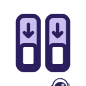 | 101 | **Gravedad** | Las cartas van en columnas. Solo juegas la de abajo; al quitarla, la columna cae |
| 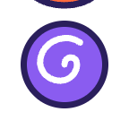 | 151 | **Nebulosa** | Solo ves 3 grupos de cartas. Vacía cualquiera y de la nebulosa sale otro |
|  | 201 | **Hangar** | Columnas que salen de un hangar. Cuando vacías una, las demás se recorren y sale otra |
|  | 251 | **Bitácora** | Hojas encimadas. Por las escotillas se ven cartas de la hoja de abajo y se pueden jugar |
|  | 301 | **Marea** | Cada 3 robos sube el agua y tapa las cartas de abajo; cada 3 jugadas baja |
|  | 351 | **Agujero negro** | Cada 4 jugadas o robos se traga las cartas y las escupe con los números revueltos |
| 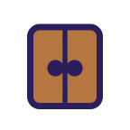 | 401 | **Puertas** | Detrás de cada puerta hay cartas. Juega una carta llave y escoge cuál abrir |
|  | 451 | **Banda transportadora** | Las cartas dan vueltas y solo ves 4 a la vez. ¡Atrápalas cuando pasen! |
| 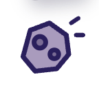 | 501 | **Cinturón de asteroides** | Cada 4 robos caen piedras que tapan cartas 3 turnos |
| 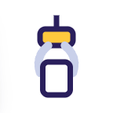 | 551 | **Grúa de feria** | Las grúas jalan las columnas hacia arriba: solo juegas la de hasta arriba y la garra se la lleva |
|  | 601 | **Mesa que se voltea** | Columnas dentro de una cápsula que da media vuelta cada 5 jugadas o robos |
|  | 651 | **Cohete** | Un cohete muy largo que avanza al limpiar. Cada tramo vacío regala monedas |
| 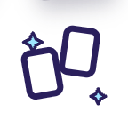 | 701 | **Gravedad cero** | Las cartas flotan: con cada jugada una flota y cae encima de otra |
|  | 751 | **Planetas en órbita** | La carta con un planeta encima no se juega. Con cada turno avanzan |
|  | 801 | **Meteoro fugaz** | Cada 4 turnos cruza un meteoro y voltea el orden de las cartas que toca |
| 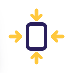 | 851 | **Cartas al vuelo** | Cada hueco esconde una pila: al jugar su carta, la siguiente llega volando |

También hay dos «ayudantes» que van como mesa: **Peter el astronauta** (171), que te guarda una carta, y la **nave ladrona** (431), que se lleva cartas de tu mazo cada pocos robos (con racha de 4 te regresa la última).

---

## Cartas especiales

Llegan dos entre cada mesa. La primera vez sale su ventana con un ejemplo.

### Se abren después

| | Nivel | Carta | Qué hace |
|:-:|---|---|---|
| 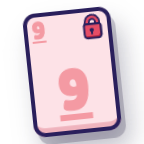 | 11 | **Candado** | No se juega hasta que juegues la carta con la **llave** del mismo color |
| 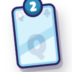 | 71 | **Hielo** | Se derrite: cada carta que juegas del tablero le quita 1 |
| 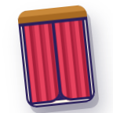 | 231 | **Cortina** | Sigue boca abajo hasta que juegues la carta con el telón |
| 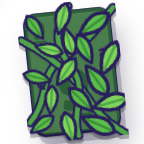 | 521 | **Enredadera y fuego** | La enredadera crece y tapa cartas; la carta de fuego las quema todas |
| 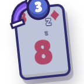 | 581 | **Dormida** | Despierta cuando llevas su número de cartas seguidas sin robar |
| 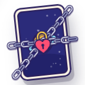 | 721 | **Candado de palo** | Encadenada: cada carta de su palo rompe una cadena; con 3 se abre y da monedas |

### Cambian con los turnos

| | Nivel | Carta | Qué hace |
|:-:|---|---|---|
| 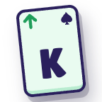 | 331 | **Carta viva** | Su número sube o baja con cada jugada o robo |
| 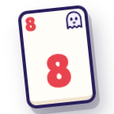 | 381 | **Fantasma** | Aparece y desaparece cada 2 turnos; solo se juega cuando se ve |
| 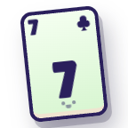 | 421 | **Camaleón** | Cada 3 turnos se vuelve comodín y luego regresa a su número |
| 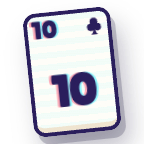 | 871 | **Clon** | Copia a la carta de al lado; cuando esa se va, se transforma en la siguiente |

### Reglas al jugar

| | Nivel | Carta | Qué hace |
|:-:|---|---|---|
| 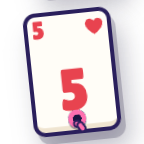 | 121 | **Gemelas** | Atadas con un lazo: al jugar una, la otra sale de donde esté y cae al descarte |
| 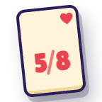 | 131 | **Carta doble** | Vale dos números: juégala con cualquiera y sigue desde cualquiera |
| 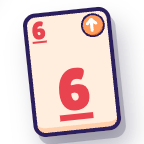 | 181 | **Flecha** | La siguiente jugada tiene que ser uno más (↑) o uno menos (↓) |
| 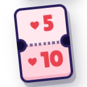 | 321 | **Boleto partido** | Dos mitades: juega una y la otra se queda para después |
| 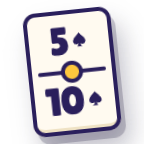 | 621 | **Dominó** | Dos números: entra por uno y en el descarte queda el otro |
| 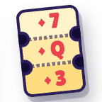 | 631 | **Boleto triple** | Tres talones: arranca el de una punta; el de en medio, cuando quede en la orilla |
| 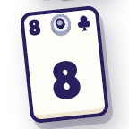 | 771 | **Cartas con cable** | Al jugar una, el cable jala a la otra y la deja en su lugar |
| 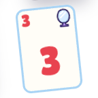 | 781 | **Espejo** | En el descarte vale su opuesto: A↔K, 2↔Q, 3↔J… el 7 se queda |
| 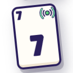 | 821 | **Eco** | La siguiente jugada también puede ser del mismo número |

### No se juegan

| | Nivel | Carta | Qué hace |
|:-:|---|---|---|
| 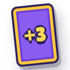 | 21 | **Carta regalo** | Destápala y mete cartas extra a tu mazo |
| 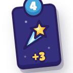 | 221 | **Cometa** | Destápalo antes de que su cuenta llegue a 0 y suma a tu racha |
| 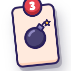 | 281 | **Bomba** | Destápala antes de que llegue a 0 o explota y quema 3 cartas de tu mazo |

### Te ayudan

| | Nivel | Carta | Qué hace |
|:-:|---|---|---|
| 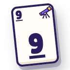 | 81 | **Telescopio** | Por 3 turnos se ven todas las cartas, también las tapadas |
| 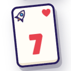 | 271 | **Cohete turbo** | Tus 3 jugadas siguientes valen doble en la racha |
| 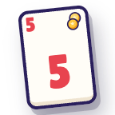 | 371 | **Carta moneda** | Se juega normal y te da monedas |
| 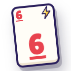 | 471 | **Rayo** | Manda de 1 a 3 cartas enterradas a tu mazo |
| 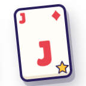 | 481 | **Constelación** | Juega todas las de estrellita seguidas y ganas un premio |
| 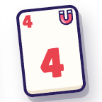 | 531 | **Imán** | Tu siguiente robo saca la carta que más te sirve, sin cortar la racha |
| 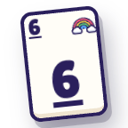 | 571 | **Arcoíris** | Tus 3 jugadas siguientes pueden saltar dos (del 6 al 8) |
| 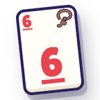 | 671 | **Lazo** | Escoges cualquier carta del tablero y va directo al descarte |
| 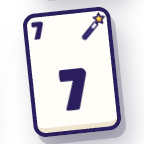 | 681 | **Varita** | Le subes o bajas hasta 3 a una carta libre |
| 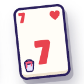 | 731 | **Pintura** | Juega 3 seguidas del mismo color y la brocha pinta una carta extra |
| 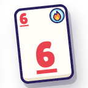 | 831 | **Burbuja de racha** | Tu siguiente robo revienta la burbuja en lugar de tu racha |

---

## Jefes de constelación

En el nivel 100 de cada constelación. Nunca se ven: solo lo que hacen. Antes de atacar, algo **tiembla** para avisarte. Cada carta que juegas en racha le baja vida; si se la acabas, te deja un premio más grande. Lo que hace un jefe no se puede deshacer, pero el reloj de arena lo detiene.

| | Nivel | Jefe | Qué hace | Cómo le ganas |
|:-:|---|---|---|---|
|  | 100 | **Fénix estelar** | Cae fuego sobre las cartas libres y tapa sus números por partes | Las sigues pudiendo jugar; con racha de 5 el fuego baja |
| 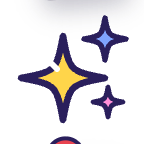 | 200 | **El Ilusionista** | Cambia el número de todas las cartas boca arriba | Juega antes las que te sirven |
|  | 300 | **Medusa de plasma** | Pone chispas: esas cartas solo entran sobre una de su mismo color | Con 4 seguidas se apaga una |
|  | 400 | **Viento solar** | Sopla y se lleva cartas de tu descarte | Con 3 seguidas tu descarte pesa y pierde vida |
|  | 500 | **Mano alien** | Se lleva cartas de arriba de tu mazo | Con 5 seguidas sin robar te las regresa |
|  | 600 | **Kraken** | Salpica tinta y bloquea cartas | Con 3 seguidas lavas una mancha |
|  | 700 | **Ballena glotona** | Se traga cartas y 3 turnos después las escupe encima de otras | Juega las escupidas para destapar |
|  | 800 | **Reloj del vacío** | Rebobina: tus últimas cartas regresan a la mesa congeladas | Con 4 seguidas sellas tu descarte |

Después del 800 vuelven a empezar, cada vuelta con más vida.

**Arena de jefes:** desde que ganas el nivel 100, la corona del mapa te deja volver a pelear contra los jefes que ya venciste, en Tranquilo, Normal o Furioso, con tablero nuevo cada vez. Es solo por gusto: no da premios.
